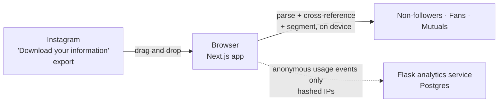

<p align="center">
  <a href="https://www.unfollowr.app">
    
  </a>
</p>

<h3 align="center">See who doesn't follow you back on Instagram — without handing over your password</h3>

<p align="center">
  Every "who unfollowed me" app wants your Instagram login or drives an unofficial API that gets accounts flagged.<br>
  Unfollowr reads the data export Instagram already gives you, entirely in your browser.
</p>

<p align="center">
  <a href="https://www.unfollowr.app">🌐 Try it at unfollowr.app</a> ·
  <a href="SECURITY.md">🔒 Security</a> ·
  <a href="#-run-it-locally">🚀 Run locally</a>
</p>

<p align="center">
  
  
  
</p>

<p align="center">
  <sub>
    👥 ~2,000 unique users all-time ·
    📊 278 analyses in the last 28 days ·
    🔐 0 passwords collected
    <br>
    <i>As of August 2026, from the app's own usage analytics.</i>
  </sub>
</p>

<!-- HERO: the results dashboard after an analysis — the non-followers list with
segment chips (brand / creator / spam) and the charts row. Better: a short GIF
of drag-dropping the export files and landing on results, showing the whole
loop. Use a test account's export, not a real person's followers.
Save as docs/media/demo.gif (keep under 5MB) and replace this comment with:
<p align="center"></p>
-->

---

### Menu

- [Features](#-features)
- [The problem](#-the-problem)
- [How it works](#-how-it-works)
- [Run it locally](#-run-it-locally)
- [Scope and non-goals](#-scope-and-non-goals)
- [Tradeoffs](#-tradeoffs)
- [Known limitations](#-known-limitations-and-failure-modes)
- [What I'd do next](#-what-id-do-next)
- [Stack](#-stack)

---

## ✨ Features

- **Non-followers, fans, and mutuals** from one drag-and-drop of Instagram's official export (HTML or JSON)
- **Parsed entirely in the browser** — follower lists never leave your device, and there's no upload endpoint
- **No account, no login, no API** — nothing for Instagram to detect, so nothing to get banned for
- **Automatic segmentation** of non-followers into brands, creators, likely spam, and likely friends
- **Filtering and charts** to work through a long list quickly

---

## 🧩 The problem

Every "who unfollowed me" app asks for one of two things: your Instagram
password (a phishing risk) or permission to drive an unofficial API (a ban
risk — Instagram's anti-bot systems flag third-party clients). But Instagram
already gives users their data: the official "Download your information"
export ships followers and following as HTML or JSON. Unfollowr reads that
export instead. There is nothing to log into and nothing for Instagram to
detect.

<!-- TODO: verify — one line on how the problem was discovered (own
experience? watching friends use credential apps?). See README-QUESTIONS.md. -->

---

## 🔧 How it works



- **The live product is the Next.js app in `next/`.** Export files are parsed
  entirely in the browser — followers and following lists never leave the
  device. There is no upload endpoint and no user account.
- **Cross-referencing and segmentation.** The two lists are cross-referenced
  into non-followers, fans, and mutuals. Each non-follower is segmented
  (brand, creator, spam, likely-friend) by a client-side heuristic over
  username and bio tokens in `next/lib/classify.ts`.
- **The only data that leaves the browser** is anonymous usage analytics,
  posted to a small Flask service that writes events to Postgres with hashed
  IPs.
- **The previous generation is still in the repo:** a server-rendered Flask
  app (`app.py`, `templates/`) that parses uploads server-side with
  BeautifulSoup and classifies accounts with Gemini. The live product replaced
  it; the Flask service's current job is collecting analytics.

---

## 🚀 Run it locally

Requirements:

- [Node 18+](https://nodejs.org/) for the app
- [Python 3.11](https://www.python.org/downloads/) only if you want the analytics service or the legacy app

The frontend is self-contained — the product works with no backend at all.

```bash
git clone https://github.com/cole-hackman/unfollowr.git
cd unfollowr/next
npm install
npm run dev    # http://localhost:3001
```

Then upload the followers/following HTML or JSON files from Instagram's
"Download your information" export.

<details>
<summary><b>Running the Flask service (analytics collector + legacy app)</b></summary>

```bash
cd unfollowr
python -m venv .venv && source .venv/bin/activate
pip install -r requirements.txt
python app.py   # http://localhost:5000
```

Set `DATABASE_URL` for Postgres analytics and `GEMINI_API_KEY` for the legacy
classification path; without them the app runs with those features disabled.
There is no `.env.example` — those two plus `SESSION_SECRET`, `ADMIN_SECRET`,
and `ADMIN_PASSWORD_HASH` are the full set.

</details>

---

## 🎯 Scope and non-goals

**In scope:** analyzing your own exported Instagram data — non-followers,
fans, mutuals, heuristic segmentation, filtering.

**Not in scope:**

- Anything that touches Instagram itself, official API or not. No login, no
  scraping, no automation. That constraint is the entire premise.
- Unfollowing for you. The app tells you who; the tapping is yours.
- Accounts or server-side history. Your data isn't stored, so there's nothing
  to sync or leak.

---

## 🔀 Tradeoffs

**Local-first parsing instead of server processing.** The previous generation
uploaded exports to Flask and classified accounts with Gemini. The rewrite
moved parsing into the browser. What it bought: the privacy claim that
differentiates the product, zero data liability, and nothing to scale. What
it cost: the LLM classifier — sending follower lists to a server for Gemini
would break the promise, so the live app uses a token-heuristic port that
misclassifies more.

**The official data export as the only input.** What it bought: zero ban
risk and no credentials, which competitor apps can't say. What it cost: real
onboarding friction — users must request the export and wait for Instagram
to prepare it — and the parser is coupled to an export format Instagram can
change without notice.

---

## 🚧 Known limitations and failure modes

- The export format is the single point of failure. Instagram can reshape the
  HTML/JSON at any time, and there are **no automated tests** — no parser
  fixtures, no CI — so a format change would surface as user reports, not a
  failing build.
- The Next app's own `/api/metrics` route validates events and then discards
  them; it stores nothing. The real analytics path is the Flask endpoint, and
  it silently no-ops unless `NEXT_PUBLIC_API_URL` was set at build time.
- Two env vars name the same backend (`NEXT_PUBLIC_API_URL` in
  `lib/analytics.ts`, `NEXT_PUBLIC_API_BASE_URL` in `lib/metrics.ts`) — set
  one and the other's events silently vanish.
- Heuristic segmentation fails in predictable ways: a friend with "designer"
  in their bio becomes a creator; a brand without brand-words passes as a
  person.
- Observability is the analytics events themselves. No error tracking, no
  alerting — a client-side parse failure is invisible unless a user emails.

---

## 🧭 What I'd do next

1. **Parser fixture tests** built from sanitized real exports — the
   highest-risk surface has zero coverage today.
2. **Collapse the two analytics helpers into one** and delete the dead
   `/api/metrics` route.
3. **Archive the legacy Flask upload UI** so the repo contains one product,
   keeping the analytics service.
4. **Explore opt-in LLM segmentation** for users willing to send usernames
   (not full lists) — the heuristic's misclassifications are its weakest spot.

---

## 🧱 Stack

| Layer | Technology |
|---|---|
| App (live) | Next.js 14 · React 18 · TypeScript · Tailwind CSS · Chart.js |
| Analytics service | Flask · Python 3.11 · PostgreSQL |
| Legacy app | Flask · BeautifulSoup · Gemini |

## About

Unfollowr is not affiliated with or endorsed by Instagram or Meta.

Built by [Cole Hackman](https://colehackman.com).
